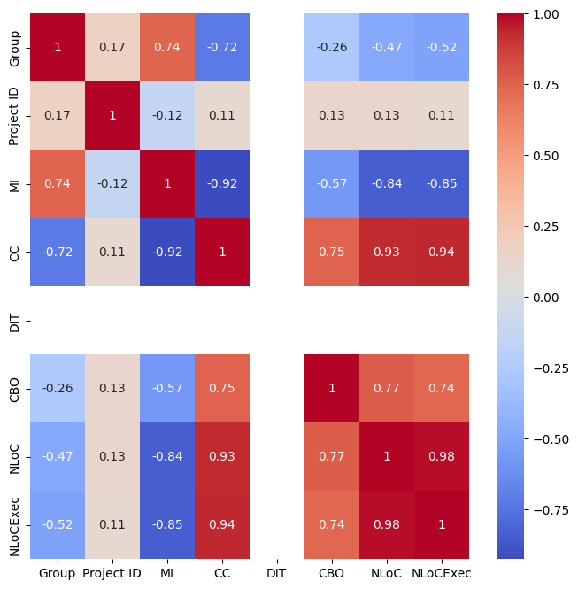
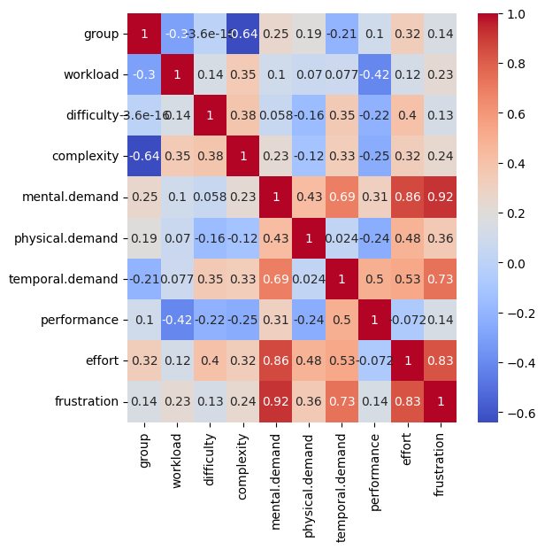

# Analyse statistique d'une expérimentation sur l'immuabilité en C#

Travail II (« Qualité & Métriques ») du cours **PIF6005 — Sujets spéciaux en informatique III**, Université du Québec à Trois-Rivières, hiver 2024.

*English summary below.*

## En bref

C# a ajouté récemment des fonctionnalités qui facilitent le style de programmation immuable. Une expérimentation contrôlée a été menée pour mesurer leur effet. Des participants ont développé le même simulateur de fichiers en C# :

- un **groupe de traitement**, formé aux nouvelles fonctionnalités ;
- un **groupe de contrôle**, qui n'y avait pas accès.

Ce travail analyse en Python les deux jeux de données de l'expérimentation : les métriques de qualité des 12 programmes produits, et un sondage de charge de travail rempli par 10 participants. Pour chaque variable, il teste la normalité, puis compare les deux groupes.

**Constat principal.** Les programmes du groupe de traitement ont un **indice de maintenabilité plus élevé** (93,5 contre 92,0) et une **complexité cyclomatique plus faible** (59,0 contre 77,5). Les deux différences sont significatives. Le sondage ne montre en revanche aucune différence significative dans la charge de travail perçue.

## Démarche

Pour chacun des deux jeux de données :

1. statistiques descriptives globales et par groupe ;
2. matrice de corrélation de Pearson ;
3. histogrammes et boîtes à moustaches ;
4. test de normalité de Shapiro-Wilk ;
5. comparaison des groupes : test t de Student pour les variables jugées normales, test de Mann-Whitney sinon.

## Résultats

### Métriques des programmes (6 projets par groupe)

| Variable | Contrôle | Traitement | Test | Statistique | p |
|---|---|---|---|---|---|
| MI (indice de maintenabilité) | 92,00 | 93,50 | t de Student | −3,50 | **0,006** |
| CC (complexité cyclomatique) | 77,50 | 59,00 | t de Student | 3,27 | **0,008** |
| DIT (profondeur d'héritage) | 1 | 1 | t de Student | non défini | — |
| CBO (couplage entre objets) | 25,67 | 25,33 | Mann-Whitney | 22,0 | 0,523 |
| NLoC (lignes de code) | 386,83 | 335,83 | Mann-Whitney | 30,0 | 0,065 |
| NLoCExec (lignes exécutables) | 110,50 | 84,33 | Mann-Whitney | 31,0 | **0,041** |

### Sondage de charge de travail (5 participants par groupe, échelles de type NASA-TLX)

Aucune des neuf variables ne diffère significativement entre les groupes : charge de travail, difficulté, complexité, demandes mentale, physique et temporelle, performance, effort, frustration. La plus faible valeur de p est celle de la complexité perçue (3,2 contre 2,2 ; Mann-Whitney p = 0,070).

<p align="center">
  
  
</p>

## Organisation du dépôt

```
notebooks/analyse_statistique_immuabilite_csharp.ipynb   Analyse complète (sorties conservées)
docs/
├── rapport_partie1_mesures_programmes.pdf              Partie I : métriques des programmes
└── rapport_partie2_sondage.pdf                         Partie II : sondage
results/figures/                                        Matrices de corrélation, histogrammes
data/README.md                                          Description des deux fichiers CSV
```

Le notebook est présenté tel qu'il a été exécuté, avec ses sorties.

## Écarts relevés

Le travail est présenté tel qu'il a été remis. Une relecture a mis en évidence les points suivants, rapportés ici par transparence.

- **Test de normalité sur les deux groupes réunis.** Le test de Shapiro-Wilk est appliqué à chaque variable sur l'échantillon complet, groupes confondus. Le test t suppose plutôt la normalité à l'intérieur de chaque groupe. Le choix entre test t et Mann-Whitney repose donc sur un critère qui ne correspond pas exactement à l'hypothèse à vérifier.
- **DIT constant.** Toutes les valeurs de DIT valent 1. SciPy signale que l'échantillon n'a aucune étendue. Le p = 1 obtenu n'indique donc pas une « parfaite adéquation à la loi normale », comme l'écrit le rapport. Le test t correspondant renvoie une valeur non définie (NaN), que le notebook affiche comme « pas de différence significative ».
- **Comparaisons multiples.** Cinq tests sur les métriques et neuf sur le sondage sont faits sans correction. Avec une correction de Holm sur les cinq métriques testables, MI et CC restent significatifs, mais NLoCExec ne l'est plus.
- **Taille des échantillons.** Avec 6 projets et 5 répondants par groupe, la puissance des tests est faible. Certaines conclusions du rapport s'appuient sur des différences de moyennes ou des corrélations non significatives, notamment pour le sondage, et les présentent comme des effets des nouvelles fonctionnalités.
- **Variances.** Le test t est appliqué sous l'hypothèse de variances égales (option par défaut de SciPy), sans vérification préalable.

## Compétences mises en œuvre

Python · pandas · SciPy (Shapiro-Wilk, t de Student, Mann-Whitney) · statistiques descriptives et corrélations · Matplotlib/Seaborn · métriques de qualité logicielle (MI, CC, DIT, CBO, LoC) · Google Colab

## Auteure

**Mireille Kafando**, M. Sc. en mathématiques et informatique appliquées (génie logiciel), UQTR

Travail réalisé dans le cadre du cours PIF6005, hiver 2024.

---

## English summary

Assignment for **PIF6005** (Université du Québec à Trois-Rivières, Winter 2024): statistical analysis of a controlled experiment on new C# language features for immutable programming. A treatment group trained on the features and a control group without them built the same file-system simulator.

- **Data:** code metrics of 12 programs (maintainability index, cyclomatic complexity, DIT, CBO, lines of code) and a NASA-TLX-style workload survey from 10 participants.
- **Method:** descriptive statistics, Pearson correlations, Shapiro-Wilk normality tests, then Student's t-test or Mann-Whitney U per variable (Python, pandas, SciPy).
- **Findings:** the treatment group's programs have a **higher maintainability index** (93.5 vs 92.0, p = 0.006) and **lower cyclomatic complexity** (59.0 vs 77.5, p = 0.008). Executable lines of code are also lower (p = 0.041), but that result does not survive a Holm correction. The survey shows no significant differences.
- **Known issues:** the assignment is shown as submitted. A post-hoc review found some issues:
  - normality was tested on the pooled sample rather than within groups;
  - DIT is constant, so its p = 1 and its NaN t-test are not informative;
  - no correction was applied for multiple comparisons;
  - samples are very small (5–6 per group).

  They are listed in *Écarts relevés*.

The experimental data were provided through the course portal and are not redistributed; see `data/README.md`.
